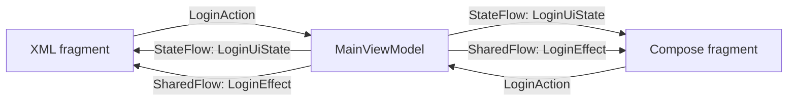

# StateFlow and SharedFlow: XML and Compose

I keep this repository as a reference for Android architecture and implementation choices. It started as a small Kotlin login example. Revisiting it with more experience gave me a way to document how I would expand that architecture today, using patterns I work with in production.

The current example has XML with View Binding and Jetpack Compose implementations sharing one ViewModel. Use the **Use Compose** switch to compare them. The inputs, login attempt, and dialog state follow you between screens.

The README explains the architecture and tradeoffs. KDoc at the top of each Kotlin source file explains its methods, implementation choices, and role in the example. Layouts and build configuration have equivalent comments. The intention is to make this repository useful when I need to revisit a pattern, compare approaches, or extend the example later.

## Try it

Enter `username` and `password` for a successful login. Other nonblank credentials fail after one second. Submitting blank inputs shows a validation Snackbar. Clear opens a confirmation dialog; confirming cancels any pending login, empties the form, and shows a Snackbar.

Try switching while login is loading, rotating with a result dialog open, or switching immediately after a Snackbar. The screen state stays available. An old Snackbar is not replayed on the next screen.

## Shared architecture

`MainActivity` hosts either `XmlLoginFragment` or `ComposeLoginFragment`. Both use `activityViewModels()` to obtain the same `MainViewModel`. Replacing the fragment destroys the old view and its collectors. The ViewModel remains alive for the activity.



Only the selected screen is mounted. The diagram shows the two implementations of the same contract, not two simultaneous collectors.

| Contract | Holds | Examples |
| --- | --- | --- |
| `LoginAction` | Input from either UI | Change username, submit, confirm clear, dismiss result. |
| `StateFlow<LoginUiState>` | The current screen state | Inputs, idle/loading/success/failure, clear confirmation. |
| `SharedFlow<LoginEffect>` | Temporary messages | Missing credentials and form cleared. |

### StateFlow

`uiState` declares a public `StateFlow<LoginUiState>` with an explicit `MutableStateFlow` backing field. The ViewModel owns the form values, so switching screens does not require copying text between UI implementations.

Login sets `Loading` immediately and starts a coroutine in `viewModelScope`. Further submissions are ignored while loading. Both UIs disable login and the text fields during that attempt. After one second, the ViewModel updates the status to `Success` or `Failure`.

Result dialogs are derived from state because the result must remain available after rotation, backgrounding, or switching screens. Clear confirmation takes priority over a result that arrives while it is open. Cancel reveals that result; confirm cancels the attempt and resets the form. Acknowledging or cancelling a result also resets the form.

### SharedFlow

`effects` declares a public `SharedFlow<LoginEffect>` with an explicit `MutableSharedFlow` backing field. It uses `replay = 0`, `extraBufferCapacity = 1`, and `BufferOverflow.DROP_OLDEST`. The ViewModel uses `tryEmit()` so a temporary message never holds up an action.

An active collector can receive the message once. A new collector receives no previous messages. With no subscribers, an emitted message is dropped; the extra buffer does not store it for the next screen. A slow collector can also lose an older buffered message. This is acceptable for these Snackbars. A result that the user must acknowledge belongs in `uiState` instead.

SharedFlow broadcasts to all active subscribers. It does not choose one consumer or guarantee delivery exactly once. The fragment replacement and view lifecycle keep only the selected example collecting here. See [StateFlow and SharedFlow on Android](https://developer.android.com/kotlin/flow/stateflow-and-sharedflow).

### Kotlin property design

The example uses Kotlin 2.4.21, with language and API versions pinned to 2.4. Explicit backing fields are [stable in Kotlin 2.4](https://kotlinlang.org/docs/whatsnew24.html#stable-features), so no experimental flag is needed.

```kotlin
val uiState: StateFlow<LoginUiState>
    field = MutableStateFlow(LoginUiState())
```

The declared property type is the public contract. Kotlin infers the backing field's mutable type and uses that narrower type inside `MainViewModel`. The class can call `uiState.update { ... }` and assign `uiState.value`; the XML and Compose screens see only `StateFlow<LoginUiState>`. The same pattern lets the ViewModel call `effects.tryEmit()` while callers receive `SharedFlow<LoginEffect>`.

Each flow has one property declaration. The previous underscore-prefixed backing properties and `asStateFlow()` / `asSharedFlow()` wrappers have been removed. The getter returns the field object directly. Read-only describes the compile-time API; it does not make the underlying object immutable or prevent a deliberate cast to a mutable flow type. See [explicit backing fields](https://kotlinlang.org/docs/properties.html#explicit-backing-fields).

The rest of the code uses sealed interfaces and data objects for the action, effect, and login-status cases, data classes for state snapshots, and exhaustive `when` expressions for handling them. The project uses stable features available in Kotlin 2.4.21.

## Compare the implementations

| Concern | XML and View Binding | Compose |
| --- | --- | --- |
| State collection | `viewLifecycleOwner.repeatOnLifecycle(RESUMED)` and `collect`. | `collectAsStateWithLifecycle(RESUMED)`. |
| Rendering | Set text only when different, then update progress, enabled states, and the child DialogFragment. | Pass state and an action callback to `LoginScreen`; recomposition renders changes. |
| Effect collection | A sibling coroutine inside the same lifecycle block displays a Material Snackbar. | `LaunchedEffect` with `repeatOnLifecycle(RESUMED)` displays messages through SnackbarHostState. |
| Dialogs | A child DialogFragment uses the shared ViewModel and reports actions. Its tag prevents duplicate dialogs. | An AlertDialog is present whenever `state.dialog` has a value. |
| Cleanup | The view lifecycle cancels collectors; `onDestroyView()` dismisses its Snackbar. | ComposeView uses `DisposeOnViewTreeLifecycleDestroyed`; disposal cancels the effect coroutine. |

The host activity applies system-bar, display-cutout, and keyboard insets once for both screens. Both forms scroll when space is limited and follow the system light or dark theme.

## Where to look

| File | Responsibility |
| --- | --- |
| [MainActivity.kt](app/src/main/java/com/example/stateflow/MainActivity.kt) | Host, insets, and the UI switch. |
| [MainViewModel.kt](app/src/main/java/com/example/stateflow/MainViewModel.kt) | Actions, state updates, effects, and login cancellation. |
| [model](app/src/main/java/com/example/stateflow/model) | Login credentials, UI state, actions, and effects. |
| [XmlLoginFragment.kt](app/src/main/java/com/example/stateflow/XmlLoginFragment.kt) | XML state and effect collectors. |
| [fragment_login.xml](app/src/main/res/layout/fragment_login.xml) | XML form. |
| [LoginDialogFragment.kt](app/src/main/java/com/example/stateflow/LoginDialogFragment.kt) | XML clear and result dialogs. |
| [ComposeLoginFragment.kt](app/src/main/java/com/example/stateflow/ComposeLoginFragment.kt) | ComposeView, composition disposal, and theme. |
| [LoginScreen.kt](app/src/main/java/com/example/stateflow/LoginScreen.kt) | Compose collectors in `LoginRoute` and rendering in `LoginScreen`. |
| [LoginResources.kt](app/src/main/java/com/example/stateflow/LoginResources.kt) | Shared mapping from dialogs and effects to string resources. |
| [libs.versions.toml](gradle/libs.versions.toml) | Plugin and dependency versions. |

## Recent refactor

The original example handled input, flow collection, and dialogs in one activity. The recent refactor moved the login screens into fragments under one host activity and added a Compose implementation of the same form.

- Both screens now send `LoginAction` values to one activity-scoped ViewModel and render `LoginUiState` from StateFlow.
- Kotlin 2.4 explicit backing fields give each flow one declaration with a public read-only type and private mutable storage.
- SharedFlow carries temporary `LoginEffect` messages, with its replay and buffer behavior documented alongside the code. Dialogs remain in state because they need to survive recreation and renderer changes.
- Login attempts reject duplicate submissions while loading. Confirming clear cancels a pending attempt, so it cannot display a result after the form is reset.
- The build moved from Groovy scripts, Gradle 8, AGP 8, Kotlin 1.8, and SDK 33 to Kotlin DSL, a version catalog, the current pinned toolchain below, and SDK 37.
- Tests now cover state transitions, effect delivery, lifecycle behavior, and switching between the two renderers. The generated arithmetic and package-name tests were replaced.

## How I used Codex

I used Codex to help refactor and document this existing project. I set the direction and constraints: modernize the Android setup, keep XML for the first migration, then add a switchable Compose example using the same architecture. I also asked for the repository to become a reference, with explanations in the README and source files written using my plain-language writing skill.

Codex inspected the existing code and build configuration, checked current official Android and Kotlin documentation, implemented the migration and second renderer, and ran builds, unit tests, lint, and emulator tests. The work stayed in the local repository so I could inspect and continue changing the implementation.

The AI work included defining the shared action/state/effect contract, handling cancellation and lifecycle boundaries, adding tests that compare the two UIs, and adopting Kotlin 2.4 explicit backing fields after checking their stable syntax and visibility rules. During verification, Codex corrected an ambiguous Compose test selector and a resource lookup that lint identified as configuration-dependent. The final checks are recorded below.

## Development

The project has one app module, `:app`. Its namespace and application ID are `com.example.stateflow`.

| Tool or setting | Version |
| --- | --- |
| Gradle wrapper | 9.8.1 |
| Android Gradle Plugin | 9.4.1, with built-in Kotlin |
| Kotlin and Compose compiler plugin | 2.4.21 |
| Kotlin language / API version | 2.4 / 2.4 |
| Compose BOM | 2026.09.00 |
| Java and Kotlin bytecode target | 17 |
| Minimum / compile / target Android SDK | 26 / 37 / 37 |

Use JDK 17 or newer, Android SDK Platform 37, and Android SDK Build Tools 36.0.0. Configure the SDK location through Android Studio, `ANDROID_HOME`, or an ignored `local.properties` file.

The root build script sets the Kotlin Gradle plugin dependency to match the Compose compiler version. The app uses AGP's built-in Kotlin support and applies the Compose compiler plugin. Both View Binding and Compose are enabled. Dependencies are pinned in the version catalog; Compose library versions come from the BOM. See the [Compose setup guide](https://developer.android.com/develop/ui/compose/setup-compose-dependencies-and-compiler).

```sh
./gradlew assembleDebug assembleRelease
./gradlew testDebugUnitTest lintDebug
./gradlew connectedDebugAndroidTest
```

The last command requires an emulator or connected Android device. Release APKs are unsigned; release minification is disabled.

## Tests and limits

Unit tests cover login timing and outcomes, repeated submissions, cancellation, retry, confirmation priority, and SharedFlow delivery with and without subscribers. Instrumentation tests compare form values across the UI switch, switch during login, recreate both examples, acknowledge results, and check Snackbar delivery without replay.

The XML and Compose refactor was verified on October 17, 2026 with 11 passing instrumentation tests on Android 16 (API 36). The six Compose comparison tests also passed with the current v2 test rule. The explicit backing-field follow-up passes debug/release builds, instrumentation test compilation, all 11 unit tests, and debug lint with no issues. Device tests have not been rerun for that follow-up; API 26 and API 37 runtime behavior has not been tested.

Authentication is a local simulation. There is no server, database, or navigation after success. Form values and login state survive activity recreation through the ViewModel, but are reset if Android kills the app. The selected UI is restored by FragmentManager. In-flight requests are not restored after Android kills the app.
