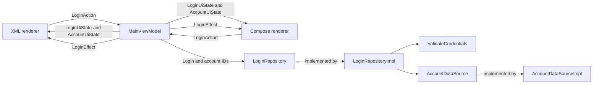

# MVVM_2026

MVVM_2026 is my reference for structuring a modern Android feature with MVVM. The project keeps the example small enough to read in one sitting while showing the boundaries I expect in production code: separate presentation, domain, and data models; explicit mapping between layers; repository contracts owned by domain; coroutine cancellation; durable state; and temporary effects.

The same login feature has XML with View Binding and Jetpack Compose renderers. The **Use Compose** switch replaces one renderer with the other while both use the same activity-scoped `MainViewModel`. The different palettes make the active renderer clear. The state, validation, repository work, and loaded account data remain the same.

This repository is intended to be read. Each Kotlin file has one main KDoc that explains its responsibility and the decisions that matter. The README describes how those files work together.

## Refactoring record

This repository began as a focused StateFlow example. The refactor turned it into a current MVVM reference without hiding that history behind a finished sample. The main changes were:

- Modernized Gradle, the Android Gradle Plugin, Kotlin, Android SDK levels, and AndroidX dependencies.
- Renamed the project, package, application ID, themes, and visible branding to `MVVM_2026`.
- Reduced the activity to hosting, renderer selection, shared ViewModel ownership, insets, and lifecycle work.
- Added XML and Compose renderers for the same feature so their state and effect handling can be compared directly.
- Split presentation, domain, and data responsibilities, with models and mappings owned by each layer.
- Moved repository contracts into domain and their concrete implementation and simulated source into data.
- Added typed credential validation, simulated authentication, account loading, cancellation, and lifecycle-aware notice dismissal.
- Replaced incidental comments with one focused KDoc per Kotlin file and tests that document the important behavior.

The refactor follows the structure this project needs now. Feature and core modules can be introduced when ownership, reuse, or build boundaries justify them.

## Run the example

Use these sample credentials:

```text
Username: username
Password: Password1!
```

The password demonstrates every required category: uppercase, lowercase, number, and symbol.

On launch, a simulated account request takes four seconds. The loading card then changes to a success notice with an eight-second countdown and a **Dismiss now** action. The countdown pauses while the activity is outside the resumed lifecycle, survives renderer changes, and respects Android's recommended accessibility timeout.

A valid login format starts a one-second credential lookup. The sample credentials succeed. Other well-formed credentials are rejected. Invalid input stays out of data access and displays typed field errors.

## Architecture



Only the selected renderer is mounted. The diagram shows two views of one feature, not two screens collecting effects at the same time.

### Presentation

Presentation owns Android UI, renderer behavior, observable UI models, actions, effects, dialogs, and resource mapping.

`MainViewModel` accepts `LoginAction` values and exposes three flows:

| Flow | Responsibility |
| --- | --- |
| `StateFlow<LoginUiState>` | Form values, field errors, login status, and dialogs. |
| `StateFlow<AccountUiState>` | Independent account loading, loaded display models, failure, and notice countdown. |
| `SharedFlow<LoginEffect>` | Temporary validation and form-cleared Snackbar messages. |

Durable information belongs in `StateFlow`. A result dialog must survive recreation, so it is derived from `LoginUiState`. Loaded accounts and the notice countdown also remain in state. Snackbars are temporary and use a non-replaying `SharedFlow`.

The effects flow has `replay = 0`, one extra buffer slot, and `BufferOverflow.SUSPEND`. The ViewModel calls `emit` from `viewModelScope`. Suspension applies backpressure when an active collector fills the buffer. With no subscriber, replay-zero effects are not retained for a later renderer. Completion of `emit` means the flow accepted the value under those rules; it cannot guarantee that UI or business work will succeed.

The project uses Kotlin 2.4 explicit backing fields:

```kotlin
val uiState: StateFlow<LoginUiState>
    field = MutableStateFlow(LoginUiState())
```

Callers receive the read-only contract. `MainViewModel` can update the inferred mutable field without a second underscore-prefixed property or a wrapper flow.

### Domain

Domain owns business models, validation rules, repository contracts, and results. It has no Android or data-layer dependencies.

`ValidateCredentials` returns typed `UsernameError` and `PasswordError` values. The rules are:

| Field | Rule |
| --- | --- |
| Username | 3-20 ASCII letters, numbers, or underscores. |
| Password | 8-64 characters with uppercase, lowercase, number, and symbol; no whitespace. |

`LoginRepository` defines login and account operations in business terms. Its results distinguish invalid input, rejected credentials, success, loaded accounts, and source failure.

### Data

Data implements the domain repository contract and owns source models, source contracts, mapping, and the local simulation.

`AccountDataSourceImpl` returns `AccountRecord` and `CredentialRecord`. `LoginRepositoryImpl` validates its boundary, compares credential fields deliberately, and maps account records into domain `Account` values. Data models never cross into the ViewModel. Domain models are mapped again into presentation models before the UI receives them.

That separation is intentional even when two models currently have similar fields. Each layer can change for its own reason without turning a source record into a UI contract.

### Dependency construction

`LoginViewModelFactory` is the composition root. It creates the data source, repository, validator, and ViewModel. The ViewModel depends on `LoginRepository`, while the factory is the only presentation entry point that knows the concrete data implementation. This example does not need a dependency-injection framework.

## Lifecycle and cancellation

The activity owns the shared ViewModel and the account-notice countdown. `repeatOnLifecycle(RESUMED)` pauses that countdown in the background. A `Mutex` prevents duplicate countdown owners from consuming time twice.

The XML fragment collects with its view lifecycle. Compose uses `collectAsStateWithLifecycle` and disposes its composition with the fragment view. Replacing a renderer cancels its collectors while the activity-scoped state continues.

Login work runs in `viewModelScope`. The ViewModel tracks the login `Job` because clearing the form must also cancel a pending result. Coroutine cancellation propagates through the repository and simulated source delay.

## XML and Compose comparison

| Concern | XML with View Binding | Compose |
| --- | --- | --- |
| State collection | `repeatOnLifecycle(RESUMED)` | `collectAsStateWithLifecycle(RESUMED)` |
| Rendering | Updates bound views from state | Recomposition renders state |
| Dialog | Child `DialogFragment` | Material `AlertDialog` |
| Temporary effects | Material `Snackbar` | `SnackbarHostState` |
| Local UI state | View properties | `remember` for password visibility and scrolling |
| Palette | Deep blue on blue-gray | Copper on sand |

Renderer colors live in presentation resources. Status colors have the same meaning in both views. Switching renderers does not change feature state or restart repository work.

## Project structure

```text
app/src/main/java/com/example/mvvm2026/
  presentation/
    MainActivity.kt
    theme/Mvvm2026Theme.kt
    login/
      MainViewModel.kt
      LoginUiMapper.kt
      LoginResources.kt
      model/
        account/
        credential/
        login/
      xml/
      compose/
  domain/
    model/
      account/
      credential/
      login/
    repository/LoginRepository.kt
    usecase/ValidateCredentials.kt
  data/
    model/
      account/
      credential/
    mapper/AccountMapper.kt
    repository/LoginRepositoryImpl.kt
    source/AccountDataSource.kt
    sourceimpl/AccountDataSourceImpl.kt
  di/LoginViewModelFactory.kt
```

Each standalone model or sealed hierarchy has its own file. Cases belonging to one sealed hierarchy stay together.

This single-module layout fits one small feature with related account and credential concerns. As an application grows, presentation, domain, and data should be organized by feature. Independently owned features and shared core capabilities can move into Gradle modules when that improves dependency direction, reuse, ownership, or build isolation. Core modules should have named responsibilities such as networking, persistence, design system, or test support; they should not collect unrelated feature models.

## Documentation conventions

Documentation explains ownership, boundaries, and behavior that is easy to misunderstand from syntax alone. Every Kotlin file has one KDoc before its main declaration with `@author Stefan Bayne` and `@since 2026-10-17`. Sealed cases remain documented by their shared hierarchy. Small methods and direct implementation details rely on clear names instead of repeated comments.

The README is the entry point for the complete example. `PROJECT_CONTEXT.md` records the project-specific decisions that should survive later changes. The reusable Android cleanup skill keeps its guidance generic and treats names from this repository as examples rather than defaults for unrelated projects.

## Toolchain

| Tool or setting | Version |
| --- | --- |
| Gradle wrapper | 9.8.1 |
| Android Gradle Plugin | 9.4.1 with built-in Kotlin |
| Kotlin / Compose compiler plugin | 2.4.21 |
| Kotlin language and API | 2.4 |
| Compose BOM | 2026.09.00 |
| Java and Kotlin target | 17 |
| Android min / compile / target SDK | 26 / 37 / 37 |

The app module enables View Binding and Compose. Dependencies are declared in the version catalog. Compose libraries use the BOM.

```sh
./gradlew assembleDebug
./gradlew testDebugUnitTest lintDebug
./gradlew connectedDebugAndroidTest
```

The instrumentation suite requires an emulator or connected device. A device with **Don't keep activities** enabled cannot launch these `ActivityScenario` tests until that developer option is disabled.

## Tests

Unit tests cover validation boundaries, source delays, repository mapping and rejection, cancellation, ViewModel state transitions, temporary-effect ordering, account loading, countdown pause/resume, manual dismissal, and duplicate countdown callers.

Instrumentation tests exercise both renderers, shared inputs, login results, validation recovery, dialogs, recreation, renderer changes, effect replay behavior, and the account notice lifecycle.

The latest verification passed 43 unit tests, 16 Android UI tests on an Android 16 emulator, debug assembly, and Android lint with no issues.

## Codex-assisted refactor

I used Codex as a coding collaborator while reverse engineering and rebuilding this example. I set the architecture, naming, documentation style, and production-informed flow decisions. Codex inspected the existing project, migrated the toolchain, implemented reviewed changes, updated tests and KDoc, and ran builds, lint, emulator checks, and visual checks on a Samsung device.

The work included moving behavior out of activities, adding the layer boundaries and separate models, implementing explicit mappings, comparing XML and Compose against one ViewModel, using Kotlin explicit backing fields, and documenting the reasoning. I reviewed the results and changed decisions as the example developed, including effect delivery, repository ownership, package structure, account-loading behavior, and UI design.

## Current limits

Authentication and account loading are local simulations. There is no API, database, or post-login navigation. The ViewModel keeps state across activity recreation; it does not restore form state after Android kills the app. Passwords are not written to saved state.

An API can replace the simulated data source later without changing the domain repository contract or the renderer contracts. That is the next useful expansion for this guide.
